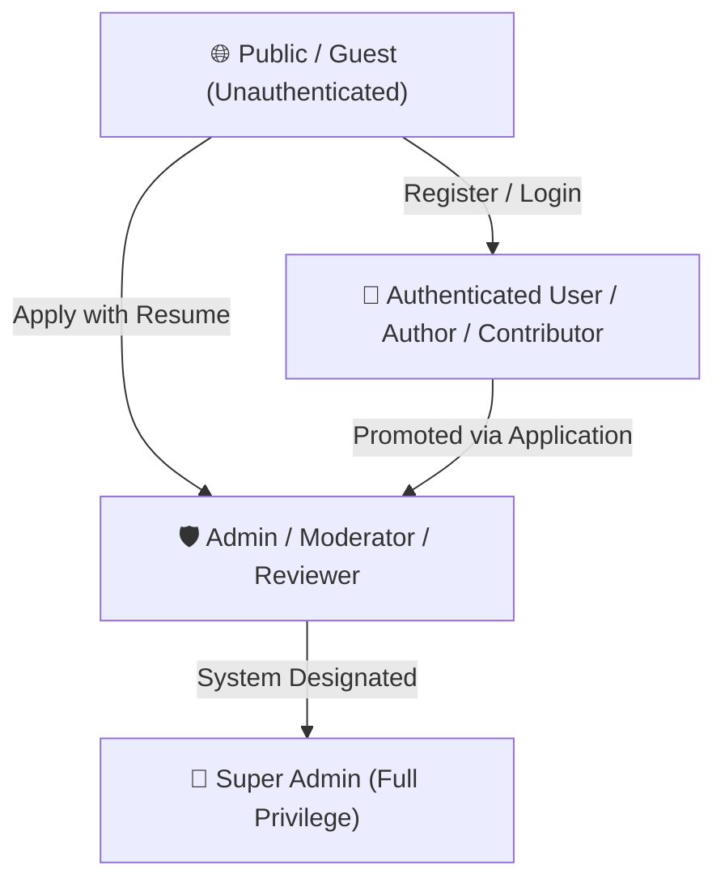
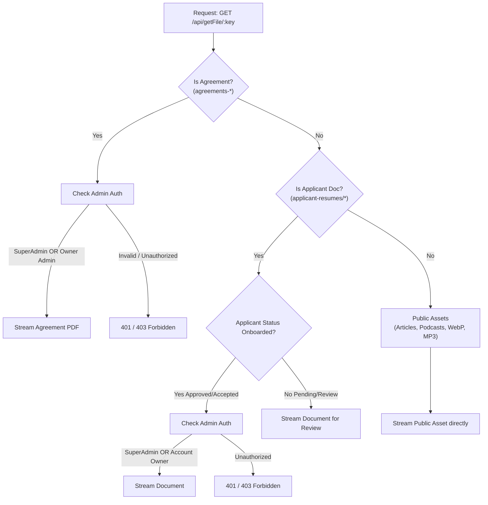

# 🛡️ Role-Based Access Control (RBAC) & Privileges Specification
**Project:** UltimateHealth Backend  
**Document Version:** `1.0.0`  
**System Versions:** API `v3.4.0` | Backend `v1.7.0`  
**Date:** October 24, 2026  

---

## 📌 1. Overview & Architecture

UltimateHealth implements a **hierarchical, defense-in-depth Role-Based Access Control (RBAC)** architecture combined with **Attribute-Based and Content-Ownership Access Control (ABAC)**. 

Access control is enforced at three distinct layers:
1. **Network & Protocol Layer:** HTTPS / TLS, CORS origin filtering, and rate limiters.
2. **Authentication Middleware Layer:** JWT token signature verification, blacklisting (JTI tracking via Redis), email verification flags, and account suspension checks.
3. **Authorization & Ownership Middleware Layer:** Fine-grained resource ownership checks (`contentOwnershipMiddleware.js`), role requirements (`superAdminMiddleware.js`), and lifecycle stage validation (e.g. Applicant $\to$ Onboarded).

---

## 👥 2. Role Hierarchy & Personas



---

## 📊 3. Role Privileges & Permissions Matrix

| Privilege / Action | 🌐 Public | 👤 User / Author | 🛡️ Moderator | 👑 Super Admin |
| :--- | :---: | :---: | :---: | :---: |
| **Read Published Articles, Podcasts, Glossary** | ✅ | ✅ | ✅ | ✅ |
| **Stream Audio, Cover Images, Avatars** | ✅ | ✅ | ✅ | ✅ |
| **Submit Admin / Reviewer Application** | ✅ | ✅ | ❌ | ❌ |
| **Create & Edit Own Content (Articles, Podcasts)** | ❌ | ✅ *(Own Only)* | ✅ *(Own Only)* | ✅ *(Any Content)* |
| **Delete Own Content** | ❌ | ✅ *(Own Only)* | ✅ *(Own Only)* | ✅ *(Any Content)* |
| **Submit Article Improvement** | ❌ | ✅ *(Assigned Only)* | ✅ *(Assigned Only)*| ✅ *(Any)* |
| **Review & Moderate Submitted Content** | ❌ | ❌ | ✅ *(Assigned Only)*| ✅ *(Any)* |
| **Publish / Discard Content** | ❌ | ❌ | ✅ *(Assigned Only)*| ✅ *(Any)* |
| **View Internal Admin Agreements** | ❌ | ❌ | ✅ *(Own Only)* | ✅ *(All Agreements)* |
| **View Onboarded Admin Resumes / Docs** | ❌ | ❌ | ✅ *(Own Only)* | ✅ *(All Resumes)* |
| **Delete S3 Files (`/deleteFile/:key`)** | ❌ | ❌ | ❌ | ✅ |
| **Delete PocketBase System Records** | ❌ | ❌ | ❌ | ✅ |
| **Review & Accept Admin Applicants** | ❌ | ❌ | ❌ | ✅ |
| **Provision Admin Profiles from Applicants** | ❌ | ❌ | ❌ | ✅ |
| **Block / Unblock Moderators** | ❌ | ❌ | ❌ | ✅ |
| **Delete Moderator Accounts** | ❌ | ❌ | ❌ | ✅ |
| **Manage Platform Languages** | ❌ | ❌ | ❌ | ✅ |

---

## 🔍 4. Detailed Role Profiles

### 4.1. 🌐 Public / Guest (Unauthenticated)
* **Identity:** Anonymous client or unregistered visitor.
* **Scope:** Read-only access to published public content and onboarding entry points.
* **Allowed Actions:**
  - View published articles (`GET /api/articles/get-article-content/:id`, `/api/articles/:id`, `/api/articles/:id/related`).
  - Search and view published glossary medical terms (`GET /api/glossary`, `/api/glossary/search`, `/api/glossary/:slug`).
  - Stream published podcast audio, playlists, and episodes (`GET /api/podcast`, `/api/podcast-episodes/:episodeId`).
  - Stream public S3 media assets (`GET /api/getFile/:key(*)`) for `.webp`, `.jpg`, `.mp3`, `.wav`, and avatars.
  - Submit application to join the editorial review board (`POST /api/admin/apply`, `POST /api/admin-agreement/apply`).
  - Send inquiries via contact portal (`POST /api/contact`).
  - Authenticate or register (`POST /api/users/login`, `POST /api/users/register`, `POST /api/admin/login`).

---

### 4.2. 👤 Authenticated User / Author / Contributor
* **Identity:** Registered platform user validated via `authenticateToken` (`req.userId`, `role: 'user'`).
* **Scope:** Personal profile management, content authoring, community engagement, and collaborative improvements.
* **Allowed Actions:**
  - **Article Lifecycle:**
    - Create new articles (`POST /api/articles`).
    - Update own drafts and in-progress articles (`PUT /api/articles/:id` — enforced: `article.authorId === req.userId`).
    - Delete own articles (`DELETE /api/articles/:id` — enforced: `article.authorId === req.userId`).
  - **Podcast & Audio Creation:**
    - Create podcasts and playlists (`POST /api/podcast`, `POST /api/podcast/create-playlist`).
    - Update/delete own podcasts (`PUT /api/podcast/update`, `DELETE /api/podcast/delete` — enforced: `podcast.user_id === req.userId`).
    - Update/delete own playlists (`PUT /api/podcast/update-playlist`, `DELETE /api/podcast/delete-playlist` — enforced: `playlist.user === req.userId`).
    - Publish/edit own episodes (`PATCH /api/podcast-episodes/:episodeId`, `DELETE /api/podcast-episodes/:episodeId` — enforced: `episode.user_id === req.userId`).
  - **Collaborative Improvements:**
    - Submit proposed revisions to published articles (`POST /api/article/submit-improvement` — enforced: strictly assigned contributor `editRequest.user_id === req.userId`).
  - **User Notifications & Interactions:**
    - Like, save, repost, comment on articles and podcasts.
    - Delete own notifications (`DELETE /api/notification/:id` — enforced: `notification.userId === req.userId`).

---

### 4.3. 🛡️ Admin / Moderator / Reviewer
* **Identity:** Verified editorial professional validated via `adminAuthenticateToken` (`req.userId`, `role: 'admin'`, `isVerified: true`, `signature_url !== ""`, `isBlocked: false`).
* **Scope:** Peer review, quality control, editorial feedback, and publication workflows.
* **Allowed Actions:**
  - **Articles Review Queue:**
    - Self-assign unassigned articles from queue (`POST /api/admin/moderator-self-assign`).
    - View active review queue and completed reviews (`GET /api/admin/articles-for-review`, `GET /api/admin/review-progress/:reviewer_id`).
    - Submit structured editorial review and feedback (`POST /api/admin/submit-review`).
    - Approve and publish peer-reviewed articles (`POST /api/admin/publish-article` — guarantees `article.reviewer_id` is preserved).
    - Discard submissions failing editorial guidelines (`POST /api/admin/discard-changes`).
    - Unassign oneself from review before completion (`POST /api/admin/unassign-moderator`).
  - **Article Improvement Queue:**
    - Pick unassigned edit requests (`POST /api/article/pick-improvement`).
    - Review changes, detect content loss (`GET /api/article/detect-content-loss`).
    - Publish approved improvements (`POST /api/admin/publish-improvement` — preserves database record and `reviewer_id`).
    - Discard improvement requests (`POST /api/admin/discard-improvement`).
  - **Podcast Review Queue:**
    - Review podcast submissions, approve and publish (`POST /api/admin/publish-podcast` — preserves `podcast.admin_id`).
    - Discard inappropriate audio submissions (`POST /api/admin/discard-podcast`).
  - **Medical Glossary Review Queue:**
    - Pick unassigned terms (`POST /api/glossary/admin/terms/:id/pick`).
    - Approve and publish glossary entries directly (`POST /api/glossary/admin/terms/:id/approve` — preserves `term.reviewerId`).
    - Send feedback to author (`POST /api/glossary/admin/terms/:id/feedback`) or reject (`POST /api/glossary/admin/terms/:id/reject`).
  - **Agreements & Profiles:**
    - Sign and upload digital PDF agreements (`POST /api/admin/upload-agreement`).
    - View personal agreement document (`GET /api/getFile/agreements-${admin._id}-...`).
    - View personal admin profile, assigned workload, and review metrics (`GET /api/admin/getmyadminprofile`).

---

### 4.4. 👑 Super Admin (Full Privilege)
* **Identity:** Platform governing administrator validated via `adminAuthenticateToken` + `requireSuperAdmin` (`isSuperAdmin: true`).
* **Scope:** Unrestricted system governance, administrator account lifecycle, data retention, infrastructure cleanup, and master settings.
* **Allowed Actions:**
  - **Universal Content Override:**
    - Edit, delete, publish, or discard ANY article, podcast, playlist, episode, or glossary term across all users.
  - **Admin & Moderator Lifecycle Management:**
    - Inspect all applicant submissions and resumes (`GET /api/admin/applicants`, `GET /api/admin/applicants/:id`).
    - Update applicant application status (`PUT /api/admin/applicants/:id/status`).
    - Provision new Admin / Moderator accounts from approved applicants (`POST /api/admin/applicants/:id/create-admin`).
    - View all active/inactive admins (`GET /api/admin/admins`).
    - Suspend / Block or Unblock moderator accounts (`PUT` & `PATCH /api/admin/admins/:id/block`).
    - Permanently delete moderator accounts (`DELETE /api/admin/admins/:id`).
    - *Safety Guardrails:* Super Admin accounts cannot be blocked or deleted via API, and admins cannot block/delete their own accounts.
  - **Confidential Storage & Cloud Asset Management:**
    - Access all internal agreements (`agreements-*`) and onboarded applicant documents (`applicant-resumes/*`).
    - Permanently delete files from AWS S3 (`DELETE /api/deleteFile/:key(*)`).
    - Permanently delete records from PocketBase collections (`DELETE /api/delete-pocketbase-record/:collectionName/:recordId`).
  - **Master Platform Configuration:**
    - Add, edit, or delete platform system languages (`POST /api/language`, `PUT /api/language/:id`, `DELETE /api/language/:id`).

---

## 🛡️ 5. Enforcement Architecture & Middlewares

### 5.1. Authentication Middlewares

#### `authenticateToken.js` (User Token Guard)
* Extracts JWT from `Authorization: Bearer <token>` or `accessToken` cookie.
* Verifies signature, issuer (`ISSUER`), and audience (`AUDIENCE`).
* Checks Redis token version / revocation status.
* Injects `req.userId` and `req.userRole = 'user'`.

#### `adminAuthenticateToken.js` (Admin Token Guard)
* Verifies JWT and confirms `decoded.role === 'admin'`.
* Fetches Admin record from database and enforces prerequisites:
  1. `admin.isVerified === true`
  2. `admin.signature_url !== ""` (signed agreement required)
  3. `admin.isBlocked !== true` (suspension check)
* Injects `req.userId = admin._id` and `req.userRole = 'admin'`.

#### `superAdminMiddleware.js` (Super Admin Privileges Guard)
* Must follow `adminAuthenticateToken`.
* Validates that `req.userId` corresponds to an admin with `isSuperAdmin === true`.
* Injects `req.superAdmin = admin`. Throws `403 Forbidden` if missing privilege.

---

### 5.2. Ownership Middleware (`contentOwnershipMiddleware.js`)

Provides unified parameter extraction (`req.params.id`, `req.body.article_id`, `req.body.requestId`, etc.) and enforces strict resource ownership:

```javascript
// Example: Article ownership guard
verifyContentOwnership("article")
// Logic:
// 1. If req.superAdmin === true -> ALLOW (Super Admin Override)
// 2. Fetch Article by ID
// 3. If article.authorId.toString() === req.userId.toString() -> ALLOW (Author)
// 4. Otherwise -> 403 Forbidden
```

Supported Resource Modes:
* `"article"`: Author (`authorId`) or Super Admin.
* `"podcast"`: Creator (`user_id`), assigned moderator (`admin_id`), or Super Admin.
* `"playlist"`: Creator (`user`) or Super Admin.
* `"episode"`: Creator (`user_id`) or Super Admin.
* `"improvement_contributor"`: Contributor (`editRequest.user_id`) only.
* `"improvement_moderator"`: Assigned reviewer (`editRequest.reviewer_id`) or Super Admin.
* `"glossary"`: Author (`authorId`), assigned reviewer (`reviewerId`), or Super Admin.

---

## 🔒 6. Storage & S3 Confidentiality Policies



1. **Agreements:** Never public. Require Super Admin or owner Admin credentials.
2. **Applicant Documents:** Public while under application review; automatically become strictly confidential upon admin onboarding.
3. **Public Content:** Zero latency streaming without authentication for regular readers and listeners.
4. **Deletions:** AWS S3 and PocketBase deletions are strictly reserved for Super Admin.
