# 🔐 User Authentication & Instant Onboarding Specification

**Project:** UltimateHealth Backend  
**Document Version:** `1.1.0`  
**System Versions:** API `v3.5.0` | Backend `v1.7.0`  
**Date:** October 30, 2026  

---

## 📌 1. Overview & Architecture

To streamline user onboarding and eliminate friction for new members and healthcare contributors, the **two-step verification flow for users has been deprecated**. 

Newly registered users (via standard email registration or Google Sign-In) are **instantly verified** (`isVerified: true`) upon account creation and **immediately issued access and refresh tokens**. Users no longer need to wait for or click an email verification link before accessing authenticated platform features.

---

## 🔄 2. Onboarding Lifecycle: Legacy vs. Current Flow

```mermaid
flowchart TD
    subgraph LegacyFlow["Legacy Flow (Deprecated)"]
        L1["Client POST /api/user/register"] --> L2["Saved to UnverifiedUser collection"]
        L2 --> L3["Verification email dispatched with JWT token"]
        L3 --> L4["User clicks /api/user/verifyEmail?token=..."]
        L4 --> L5["User migrated to User collection (isVerified: true)"]
        L5 --> L6["Client must perform separate POST /api/user/login"]
    end

    subgraph ModernFlow["Current Flow (Streamlined)"]
        M1["Client POST /api/user/register or google-auth"] --> M2["Duplicate check on User & Admin collections"]
        M2 --> M3["User created directly in User collection (isVerified: true)"]
        M3 --> M4["Synchronized to Firebase Auth / Firestore"]
        M4 --> M5["7-day Refresh Token generated & attached to user"]
        M5 --> M6["Access Token (15m) generated with Token Version"]
        M6 --> M7["Response returned with 201 Created & auth tokens"]
    end
```



---

## 🚀 3. Endpoints Specification

### 3.1 Standard User Registration

- **Endpoint:** `POST /api/user/register`
- **Access Level:** Public
- **Headers:**
  - `Content-Type: application/json`
  - `X-Client-Type: mobile` *(Optional: triggers explicit refresh token inclusion in JSON response)*
- **Request Body:**
  ```json
  {
    "user_name": "Jane Doe",
    "user_handle": "janedoe",
    "email": "jane.doe@example.com",
    "password": "StrongPassword123!",
    "isDoctor": false,
    "fcmToken": "optional_fcm_device_token",
    "contact_detail": "1234567890",
    "Profile_image": "https://example.com/avatar.png"
  }
  ```
  *(For healthcare professionals `isDoctor: true`, `qualification`, `specialization`, and `Years_of_experience` are also provided).*

- **Response:** `201 Created`
  ```json
  {
    "success": true,
    "message": "User registered successfully",
    "data": {
      "user": {
        "_id": "6722d3e4f1a2b3c4d5e6f7a8",
        "email": "jane.doe@example.com",
        "user_name": "Jane Doe",
        "isDoctor": false,
        "isVerified": true,
        "user_handle": "janedoe"
      },
      "accessToken": "eyJhbGciOiJSUzI1NiIsInR5cCI6IkpXVCJ9...",
      "refreshToken": "eyJhbGciOiJSUzI1NiIsInR5cCI6IkpXVCJ9..."
    }
  }
  ```
- **Cookie Set (for non-mobile clients):**
  - `refreshToken`: HTTP-only, Secure (in production), SameSite: Strict, Max-Age: 7 days.

---

### 3.2 Google Sign-In & Instant Registration

- **Endpoint:** `POST /api/user/google-auth`
- **Access Level:** Public
- **Behavior:**
  - If the user already exists in `User`, logs them in, attaches a new refresh token, and returns tokens.
  - If the user does not exist, registers them directly in `User` as `isVerified: true`, attaches tokens, synchronizes to Firebase, and returns `201 Created`.
  - Removes gating on legacy unverified accounts.

---

## 🛡️ 4. Token Architecture & Attachment Details

### 4.1 Refresh Token Attachment
1. **Cryptographic Signing:** Generated using RSA asymmetric signing (RS256) with custom `jti` (JWT ID) and a 7-day TTL (`JWT_REFRESH_EXPIRY=7d`).
2. **Redis In-Memory Tracking:** The active `jti` is stored in Redis:
   ```
   refresh_token:<userId>:<jti> -> "active" (TTL: 604,800 seconds)
   ```
3. **Database Persistence:** The SHA-256 hash of the refresh token and its `jti` are attached directly to the user record in MongoDB:
   ```javascript
   user.refreshToken = {
     hashedRefreshToken: "<sha256_hash>",
     jti: "<uuidv4_jti>"
   }
   ```
4. **Client Delivery:**
   - **Web / Browser Clients:** Set in an `httpOnly` secure cookie (`res.cookie('refreshToken', ...)`).
   - **Mobile / Native Clients (`x-client-type: mobile` or mobile User-Agent):** Attached to the response JSON payload for secure device storage (Keychain / EncryptedSharedPreferences).

### 4.2 Access Token Issuance
- Signed with RS256 with 15-minute validity (`JWT_ACCESS_EXPIRY=15m`).
- Bound to `user_token_version:<userId>` in Redis to allow instantaneous global session revocation on logout or password change.

---

## 🗄️ 5. Backward Compatibility & Cleanup

1. **Admin Agreement Verification:**
   - Admin account verification via `/api/user/verifyEmail?token=...&isAdmin=true` remains active, as admins must complete digital agreement execution at `/admin-agreement.html`.
2. **Stale Unverified Records Cleanup:**
   - During user registration or Google sign-up, any existing records in `UnverifiedUser` matching the email or user handle are automatically purged to prevent orphaned data.
3. **Firebase User Sync:**
   - Every newly created verified user is automatically synchronized to Firebase Authentication / Firestore via `cloneUserToFirebase(newUser)`.
